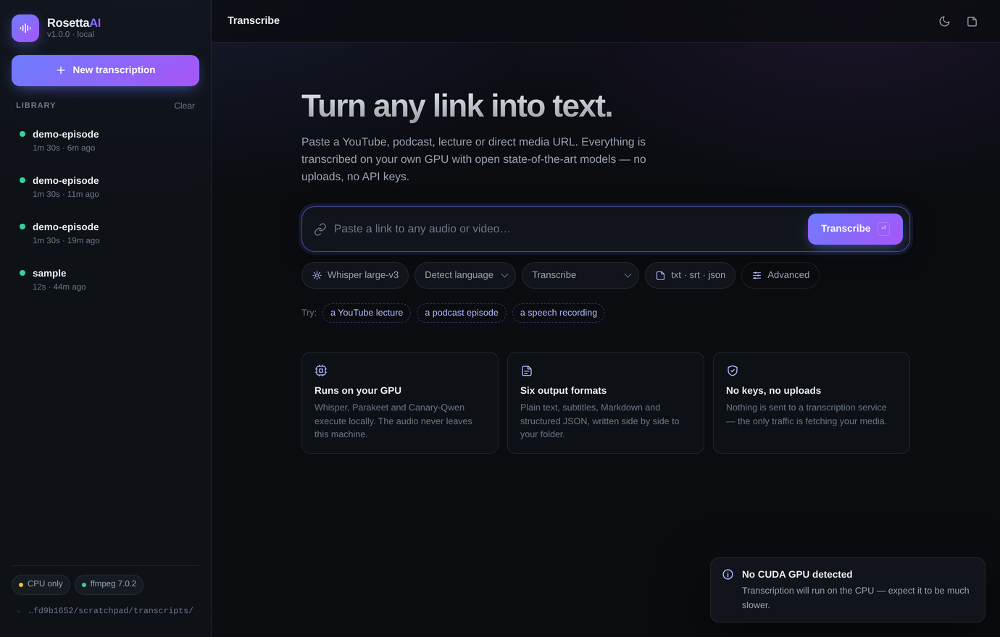
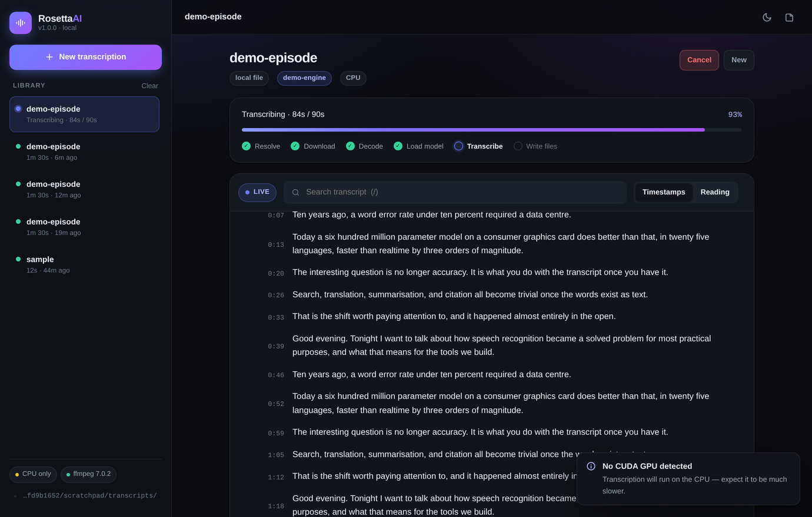
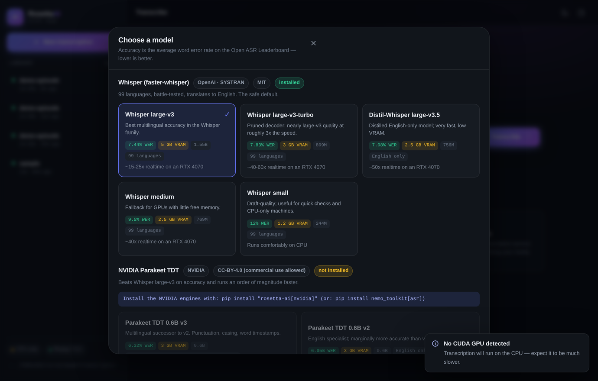

<div align="center">

# RosettaAI

**Paste a URL. Get an accurate transcript file. Nothing leaves your machine.**

A production-grade local transcription tool built around the current
state-of-the-art open speech models — with a web UI, a CLI, and a REST API.

</div>

<p align="center">
  
</p>

<p align="center">
  
  
</p>

<p align="center"><sub>
  The interface, captured in this repository's build sandbox. Model weights cannot be
  downloaded there, so the run above used the bundled test engine — hence the
  <code>demo-engine</code> badge and the placeholder text. Everything else is the real app.
</sub></p>

---

## Why this exists

Commercial transcription APIs are accurate, but they charge per minute, they
require an API key, and they need you to upload the audio. The open models have
now caught up: **NVIDIA Canary-Qwen 2.5B tops the Open ASR Leaderboard at 5.63%
WER**, ahead of Whisper large-v3, and it runs comfortably on a 12 GB consumer
GPU. RosettaAI packages those models into something you actually want to use:

- **URL in, file out.** YouTube, podcasts, lecture recordings, direct `.mp3`
  links, or a local path. `yt-dlp` handles ~1800 sites; anything else is
  streamed straight to disk.
- **Fully local.** No API keys, no uploads, no telemetry. The only network
  traffic is fetching your media and downloading model weights once.
- **A real interface.** Live per-stage progress over SSE, a searchable
  transcript viewer, a queue with history, and one-click exports.
- **Six output formats** written side by side: `txt`, `srt`, `vtt`, `json`,
  `md`, `tsv`.

## Model line-up

Pick per job in the UI, or with `--engine` / `--model` on the CLI.
WER is the Open ASR Leaderboard average — lower is better.

| Engine | Model | WER | VRAM | Languages | Best for |
| --- | --- | ---: | ---: | --- | --- |
| `canary-qwen` | Canary-Qwen 2.5B | **5.63%** | ~6.5 GB | English | Maximum accuracy on English |
| `parakeet` | Parakeet TDT 0.6B v2 | 6.05% | ~3 GB | English | Fastest accurate English |
| `parakeet` | Parakeet TDT 0.6B v3 | 6.32% | ~3 GB | 25 European + auto-ID | Best speed/coverage balance |
| `faster-whisper` | Distil-Whisper large-v3.5 | 7.08% | ~2.5 GB | English | Fast English on small GPUs |
| `faster-whisper` | **Whisper large-v3** (default) | 7.44% | ~5 GB | 99 languages | Anything multilingual |
| `faster-whisper` | Whisper large-v3-turbo | 7.83% | ~3 GB | 99 languages | Long files, in a hurry |

Only the Whisper family supports **translate-to-English**; Whisper and Parakeet
produce true word-level timings, while Canary-Qwen returns text without
timestamps (RosettaAI interpolates sentence timings inside each window and
labels them as approximate).

### On a 12 GB card (RTX 4070) with 32 GB RAM

Every model in the table fits with room to spare. A practical setup:

- **Default to Whisper large-v3** — 99 languages, translation, exact timings.
- **Switch to Parakeet TDT v3** for long English/European recordings; it is
  roughly two orders of magnitude faster than realtime, so a 3-hour podcast is
  minutes of GPU time.
- **Use Canary-Qwen 2.5B** when the transcript has to be as close to perfect as
  open models get and the audio is English.

Only one model is resident at a time; switching engines unloads the previous
one before loading the next.

---

## Run it

**Windows** - download or clone the repo, then **double-click `run.bat`**.

**macOS / Linux** - `./run.sh`

That is the whole install. The launcher fetches [uv](https://docs.astral.sh/uv/)
if you do not have it, downloads the exact Python this project pins (3.12 -
whatever is already on your machine is ignored), creates the environment,
installs the dependencies (adding the CUDA libraries only when it sees an
NVIDIA GPU), and opens <http://localhost:8420>. First run takes a couple of
minutes; after that it starts in about a second.

You never create a virtual environment, never run `pip`, and never activate
anything.

```
run.bat                                              open the web interface
run.bat transcribe https://youtube.com/watch?v=...   straight to a file
run.bat doctor                                       check the setup
run.bat models                                       list models + availability
```

The same arguments work with `./run.sh` on macOS and Linux.

### The two things that take time on a first run

1. **The dependencies** (~2 min, once). Progress is shown in the terminal.
2. **The model weights** - Whisper large-v3 is about 3 GB, downloaded the first
   time you use a model. The progress bar shows this as
   `Downloading large-v3 - 1.20 / 3.09 GB`, so it is obvious what is happening.
   Later runs load from cache in a few seconds.

### Adding the NVIDIA engines

Parakeet and Canary-Qwen need PyTorch and NVIDIA NeMo, which are several GB, so
they are opt-in:

```
run.bat install-nvidia          # Windows
./run.sh install-nvidia         # macOS / Linux
```

Then pick them from the model menu in the UI, or pass `--engine parakeet` on the
command line.

<details>
<summary><b>Installing with pip instead</b></summary>

RosettaAI is an ordinary Python package, so if you would rather manage the
environment yourself:

```bash
python -m venv .venv && source .venv/bin/activate    # Windows: .venv\Scripts\activate
pip install -e .                                     # everything needed to transcribe
pip install -e ".[cuda]"                             # + CUDA runtime libs for GPU
pip install -e ".[nvidia]"                           # + Parakeet and Canary-Qwen
rosetta
```

**ffmpeg** is used to decode audio. A static build ships with the
`imageio-ffmpeg` dependency, so it works out of the box; a system ffmpeg
(`winget install Gyan.FFmpeg`, `brew install ffmpeg`, `apt install ffmpeg`) is
used automatically when present and is a little faster.

</details>

---

## Use it

### Web UI

Paste a link, press <kbd>Enter</kbd>, watch the stages advance. Shortcuts:
<kbd>N</kbd> new, <kbd>M</kbd> model picker, <kbd>/</kbd> search,
<kbd>C</kbd> copy, <kbd>T</kbd> theme.

### CLI

```bash
./run.sh transcribe "https://www.youtube.com/watch?v=..."
./run.sh transcribe talk.m4a --engine parakeet --format txt,srt,vtt
./run.sh transcribe interview.mp3 --model large-v3 --language de --translate
./run.sh transcribe show.mp3 --quiet          # prints only the written paths

./run.sh models                                # catalogue + availability
./run.sh history -n 20                         # what you have transcribed
```

### REST API

The server is a normal FastAPI app - interactive docs at `/api/docs`.

```bash
curl -X POST localhost:8420/api/jobs \
  -H 'content-type: application/json' \
  -d '{"url":"https://example.com/ep12.mp3","options":{"engine":"parakeet","formats":["txt","srt"]}}'

curl localhost:8420/api/jobs/<id>            # status + transcript
curl -N localhost:8420/api/events            # live progress stream (SSE)
```

---

## Output

Every selected format is written to the output folder (default `./transcripts`)
sharing one stem, so a run produces e.g.

```
transcripts/
├── The-Future-of-Compute.txt     # readable paragraphs
├── The-Future-of-Compute.srt     # subtitle cues, wrapped to 42 chars
└── The-Future-of-Compute.json    # segments, timings, model + run metadata
```

## Configuration

Settings resolve from defaults → `rosetta.toml` → `ROSETTA_*` environment
variables → command-line flags.

```toml
# rosetta.toml
output_dir = "D:/Transcripts"
engine     = "parakeet"
device     = "cuda"
keep_audio = false
port       = 8420
allow_private_hosts = false   # set true to fetch from a LAN/NAS address
```

## How it works

```
URL ─▶ fetch (yt-dlp | streamed HTTP)
    ─▶ decode (ffmpeg → 16 kHz mono PCM)
    ─▶ chunk on silence  (NeMo engines only)
    ─▶ transcribe (faster-whisper | Parakeet | Canary-Qwen)
    ─▶ write txt / srt / vtt / json / md / tsv
```

| Module | Responsibility |
| --- | --- |
| `rosetta/media/` | URL resolution, downloads, ffmpeg decoding, silence-aware chunking |
| `rosetta/engines/` | Engine registry, model catalogue, the three ASR backends |
| `rosetta/pipeline.py` | Stage orchestration and unified progress |
| `rosetta/jobs.py` | Worker threads, queue, cancellation, event fan-out |
| `rosetta/store.py` | SQLite job history |
| `rosetta/writers.py` | Transcript rendering for every output format |
| `rosetta/server/` | FastAPI + SSE + the single-page UI |

Design decisions worth knowing:

- **Long audio is cut on pauses, not on a grid.** `ffmpeg silencedetect` finds
  the quietest point near each boundary so windows never split a word.
- **`condition_on_previous_text` is off** for Whisper: it is the main cause of
  the repeated-text spiral on long recordings.
- **Private addresses are refused by default**, so a browser-facing service
  cannot be pointed at internal hosts. Opt in with `allow_private_hosts`.
- **The GPU runs one job at a time.** The queue is honest about that instead of
  thrashing VRAM.

## Development

```bash
pip install -e ".[dev]"
pytest -q
ruff check src tests
```

## Prior art

Built after studying [faster-whisper](https://github.com/SYSTRAN/faster-whisper),
[WhisperX](https://github.com/m-bain/whisperX),
[Whishper](https://github.com/pluja/whishper),
[Scriberr](https://github.com/rishikanthc/Scriberr) and
[Buzz](https://github.com/chidiwilliams/buzz) — RosettaAI's contribution is the
URL-first workflow, the multi-engine catalogue with honest accuracy numbers, and
a UI that shows what the pipeline is actually doing.

## License

MIT. Model weights carry their own licenses: Whisper is MIT; Parakeet and
Canary-Qwen are CC-BY-4.0.
